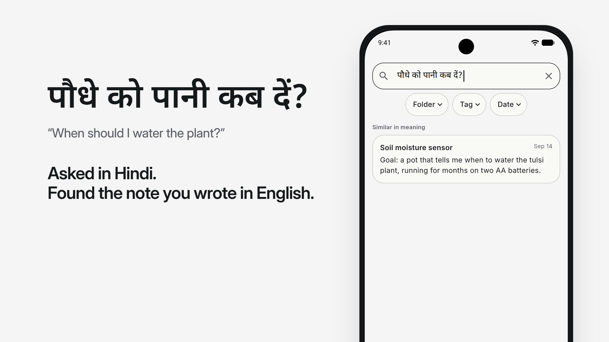
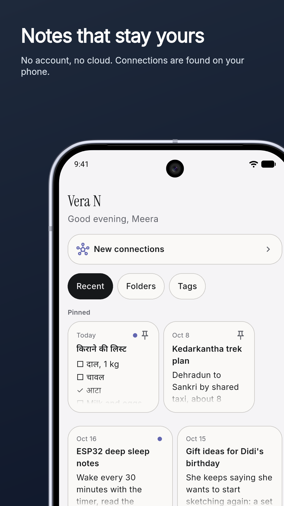
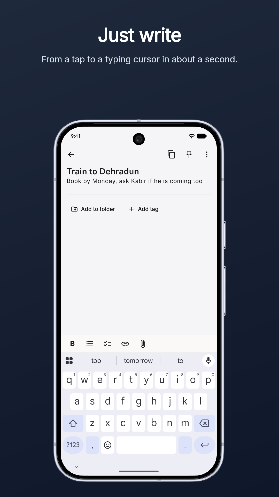
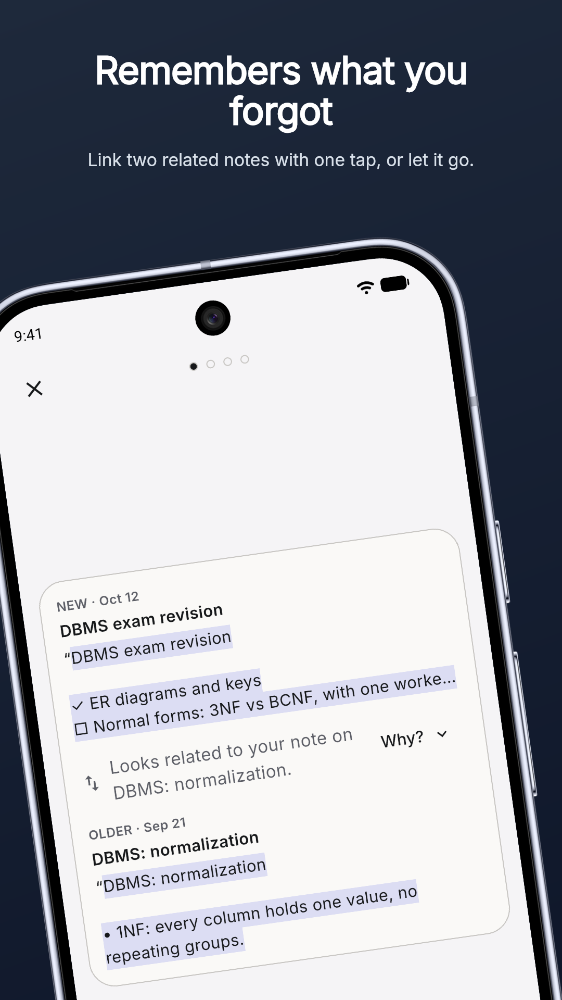
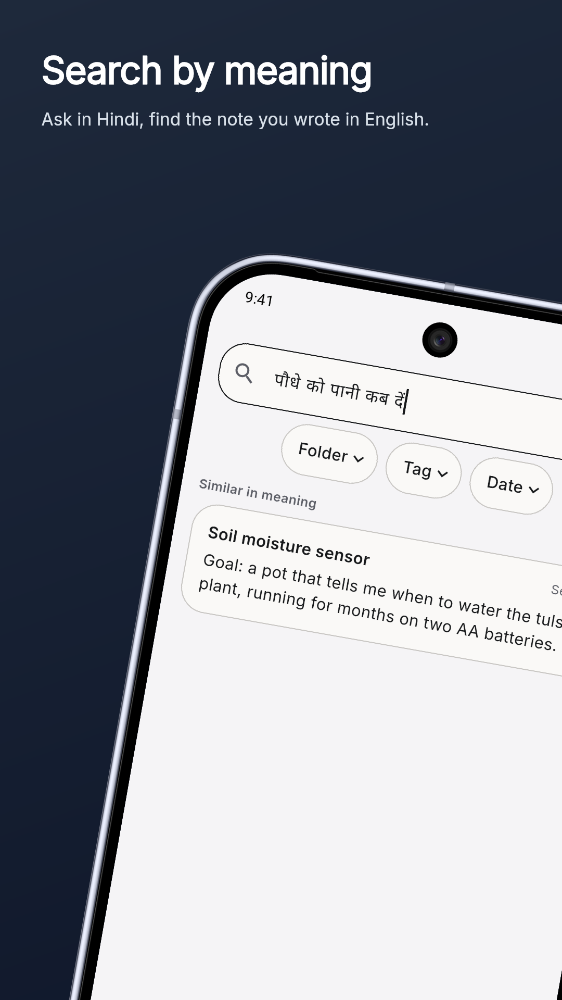
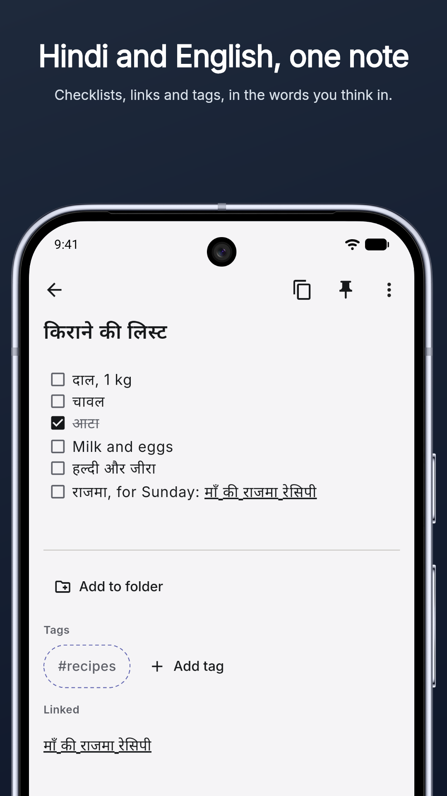

# Vera N

A local-first, privacy-first notes app. Write naturally on your phone; Vera N quietly suggests connections between your notes, and nothing changes unless you say yes. No account, no cloud.

*Vera* means truth and *N* stands for Notes. Said together, "veeran" means isolated in Hindi: private, sealed, offline.

Built with Flutter. Android first, with a Windows laptop version.

[](docs/media/vera-n-launch.mp4)

*Vera N in 22 seconds (click to play). Every screen is the real app, with made-up notes.*

<p>
  
  
  
  
  
</p>

- Product spec: [`Vera_N_Product_Spec_v3.md`](Vera_N_Product_Spec_v3.md)
- UI spec: [`Vera_N_UI_Spec.md`](Vera_N_UI_Spec.md)
- Architecture: [`docs/ARCHITECTURE.md`](docs/ARCHITECTURE.md)
- Laptop plan: [`docs/LAPTOP_PLAN.md`](docs/LAPTOP_PLAN.md)
- Changelog: [`CHANGELOG.md`](CHANGELOG.md)

## Principles

1. **Your words come first.** While you type, only your words are on screen.
2. **Everything stays on the device** unless you move it yourself.
3. **AI suggests, you decide.** Nothing changes without a yes, and every decision can be undone.
4. **Instant capture beats features.** A tap to a typing cursor in about one second.

## Features

### Capture

- **About one second from a tap to a typing cursor.** A cold start measured 683–735 ms on a test phone.
- **Home-screen widgets:** a Quick note bar (4×1) and a New note button (2×1).
- **Quick Settings tile** "New note". On a locked phone it asks you to unlock first.
- **App-icon shortcuts:** New note, Search, and Review connections (shown only while suggestions are waiting).
- **Share to Vera N:** share text or a link from any app and it becomes a new note.
- **Open app to** Home or straight into a new note (a setting).
- Notes left empty are deleted when you leave them.

### Writing

- **The editor shows formatting, not Markdown:** bold is bold, checklists have real checkboxes you can tick, bullets show as •.
- **Lists that continue themselves:** bullets, checklists and numbered lists (`1. `). Enter adds the next item and renumbers the ones below.
- **A formatting row above the keyboard:** Bold, List, Checklist, Link and Attach.
- **Links between notes** (`[[note|Title]]`, as in Obsidian). In the editor they show only their title, and tapping one opens the linked note. Each note lists **Linked** and **Mentioned in**.
- **Attachments**, placed inline at the cursor:
  - photos from the camera or gallery (shrunk and compressed);
  - drawings, saved as vector SVG so they never blur, and you can reopen them to keep drawing;
  - voice notes, with play and pause.
- **Link cards:** a shared link shows as a card with its title, description and site. Cards are built offline from what the sharing app sent; nothing is fetched from the web.
- **Reminders a note asks for:** write "remind me at 9 am tomorrow" (or "in 2 hours", "Friday", "12 Oct", …) and you get a notification. The lock screen shows only "Reminder". Phone only.
- **Hindi and English in the same note**, with Devanagari rendered cleanly.
- **Copy note** copies the note as you see it, without Markdown.

### Organizing

- **Home** with **Recent / Folders / Tags** views, in a **grid or list** layout.
- **Pin** notes, and **delete** them with Undo instead of a confirmation (long-press a card or use the note's menu).
- **Folders** you make yourself, including subfolders. The AI never moves notes.
- **Tags**, added by you or approved from suggestions.
- **Archive** moves a note into `Notes/Archive/` and keeps its folder; Unarchive puts it back.
- **Locked folder:** one folder opened with the phone's own fingerprint, face or PIN. It closes 30 seconds after you leave. Locked notes are hidden everywhere else, and the AI never reads them.
- **Trash:** Restore or Delete forever, both with Undo. Notes are removed for good after 30 days.

### Finding

- **Keyword search** as you type, with matched words highlighted, in English and Hindi.
- **Filters:** Folder (subfolders included), Tag, and Date (Today, Last 7 days, Last 30 days, This year).
- **"Similar in meaning":** after a short pause, the on-device model finds notes that are about the same thing even when the words differ.
- **Recent searches**, kept on this device.
- **Graph:** each note is a dot and each link a line.
  - Pan and pinch to zoom.
  - **Focus** on one note and its neighbours, 1 to 3 steps out.
  - Folder and Tag filters, and a search that jumps to a note.
  - Optionally shows waiting suggestions as dashed lines.
  - Past 200 notes, it groups notes into one bubble per folder.

### Smart suggestions (on-device AI)

- **Link suggestions:** a small multilingual model (MiniLM, English and Hindi, int8) runs **on the phone** and suggests strong connections between notes. Nothing leaves the device.
- **Tag suggestions:** suggests tags you already use, when very similar notes carry them.
- **Revisit:** brings back old notes (untouched for 30 days or more) that relate to what you're writing now. You can open one, or choose Not now to hide it for 30 days.
- **Review** in batches of 5: swipe or tap ✓ accept, ✕ reject, or not sure, each with Undo. You can also review from inside a note.
- **AI items look different:** dimmed with a dashed outline, so the meaning never depends on color alone.
- **Rejections are remembered**, even after a reinstall, and unreviewed suggestions expire after 30 days.
- **It learns from your choices:** if you reject most suggestions of one kind, it gets stricter for that kind; if you accept most, it gets a little looser.
- **Battery-friendly:** analysis runs only while charging by default. Only changed notes are re-analysed, and the model is loaded for a batch and then released.
- **Settings → Smart Suggestions:** turn suggestions off completely, choose to analyse only while charging, see "Last looked", rebuild suggestions, or reset rejections.

### Your data

- **Plain Markdown files** in a folder you pick (`MyNotes/Notes/`), readable by Obsidian or any editor. The app's database is only an index and can be rebuilt from the files.
- **Changes from other apps are picked up.** If a note was changed in two places, **Compare / Keep this / Keep the other / Keep both** lets you resolve it.
- **Export** every note as a `.zip` of Markdown files, in their folders.
- **Attachments clean-up:** see how much space attachments use and remove the ones no note uses.
- **No account, no cloud, no analytics or crash reporting.** The app asks for the fewest permissions it can, each only when a feature needs it.

### Laptop (Windows)

- **The full notes app**, with a desktop layout from 900 px wide: a sidebar, the notes list, and the open note side by side.
- **Keyboard shortcuts:** Ctrl+N new note, Ctrl+F search, Ctrl+B bold, Ctrl+K link a note. In Review: Ctrl+Enter accept, Delete reject, Ctrl+U not sure, Ctrl+Z undo. Right-click a card for its menu.
- **On-device analysis** runs on mains power, after 3 minutes without a key press or click, and stops at the next one.
- **Optional help from a local AI app** (for example LM Studio). Only addresses on this computer, or, if you allow it, your own network, are accepted. The local model adds:
  - a one-sentence **"Why?"** for each suggested link;
  - **copies:** notes that look like duplicates, with **Merge** (adds lines, never rewrites or removes) or Not copies;
  - **topics** and **new tag names**, offered as tag suggestions.
- **Windows installer** (Inno Setup). Installs for the current user and never touches your notes when uninstalled.
- The window opens where you last closed it.

### Sync between phone and laptop

- **Built into Settings:** no separate app and no account. It uses [Syncthing](https://syncthing.net/) inside Vera N.
- **Pair by scanning a QR code or typing six words.** Both devices prove they know the words before trusting each other.
- **Only your own Wi-Fi:** internet relays, global discovery and usage reports are off.
- Notes, rejections and the laptop's AI results travel both ways. A note changed on both devices keeps a conflict copy so you can compare.

### Accessibility and feel

- 48-point tap targets, text contrast of at least 4.5:1, and support for system text scaling.
- Screen reader labels throughout. TalkBack reads note links and checkboxes as words, not Markdown.
- Follows the system's **reduce motion** and **haptics** settings. Light, dark, or system theme.
- Primary actions sit within thumb reach for one-handed use.
- No badges, nagging counts or streaks, and the app never speaks as "Vera".

## Status

Version 0.1.0, in progress, shared on GitHub only. Built-in sync is new: pairing by typed words is checked on a real phone and laptop, but QR scanning has not yet been re-checked with the phone's camera since its last fix. See [`CHANGELOG.md`](CHANGELOG.md) for what has been checked on devices, and [`docs/BACKLOG.md`](docs/BACKLOG.md) for what is open.

## Building

Requirements: Flutter, and Git LFS (the embedding model in `assets/models/` is stored with LFS).

```sh
git lfs pull
flutter pub get
flutter test
```

- **Android:** `flutter build apk --release --split-per-abi`. Install the arm64 APK (about 70 MB) on a modern phone.
- **Windows:** needs Visual Studio with "Desktop development with C++". To make the installer, run `tool/build_windows_installer.ps1`. It needs Inno Setup 6 and writes `build/installer/VeraN-Setup-<version>.exe`.
- **Sync engine:** to include sync, run `tool/fetch_sync_engine.ps1` first. It downloads Syncthing and checks it against pinned SHA-256 hashes; the binaries are kept out of git. Builds without it simply hide the sync rows.

## Licenses

The embedding model (paraphrase-multilingual-MiniLM-L12-v2) is Apache-2.0, Syncthing is MPL-2.0, and the pairing word list is BIP-39 English (BSD-2-Clause). All of them are listed on the app's Licenses page.
